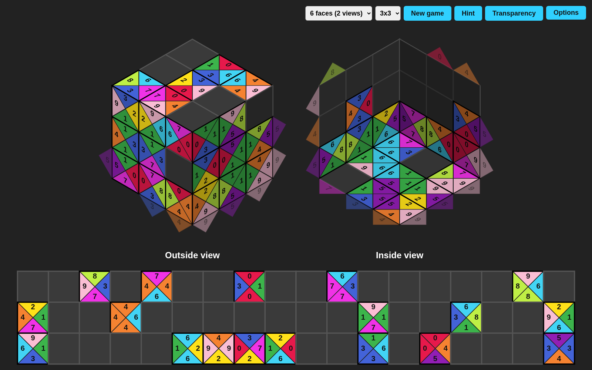

# Cube Tetravex

A browser puzzle game: [Tetravex](https://en.wikipedia.org/wiki/Tetravex) played on the faces of a cube.

Move every tile from the bottom grid onto the cube so that touching edges show the same number, including across the edges between faces. Play with 3 visible faces, or with all 6 faces shown as an outside view and an inside view.

## Vibe coded

The game has been vibe coded with opus5.5, I did not read the code once I hope this will make DHH proud.
It takes me approximately 2 hours and several prompts to generate it, and I rarely have to contradict the AI.

## Play

Open `index.html` in a browser. There is no build step and no dependency.

Click a tile, then a cell, or drag the tile there. The game also has hints, faces from 1x1 to 4x4, a transparency mode, sounds and auto-save.
